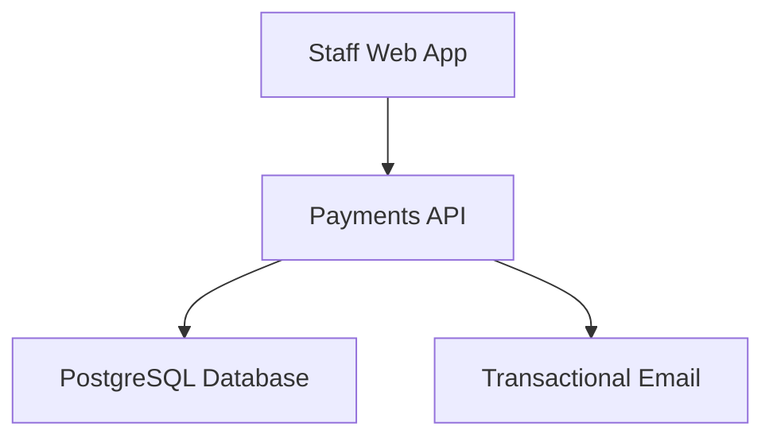
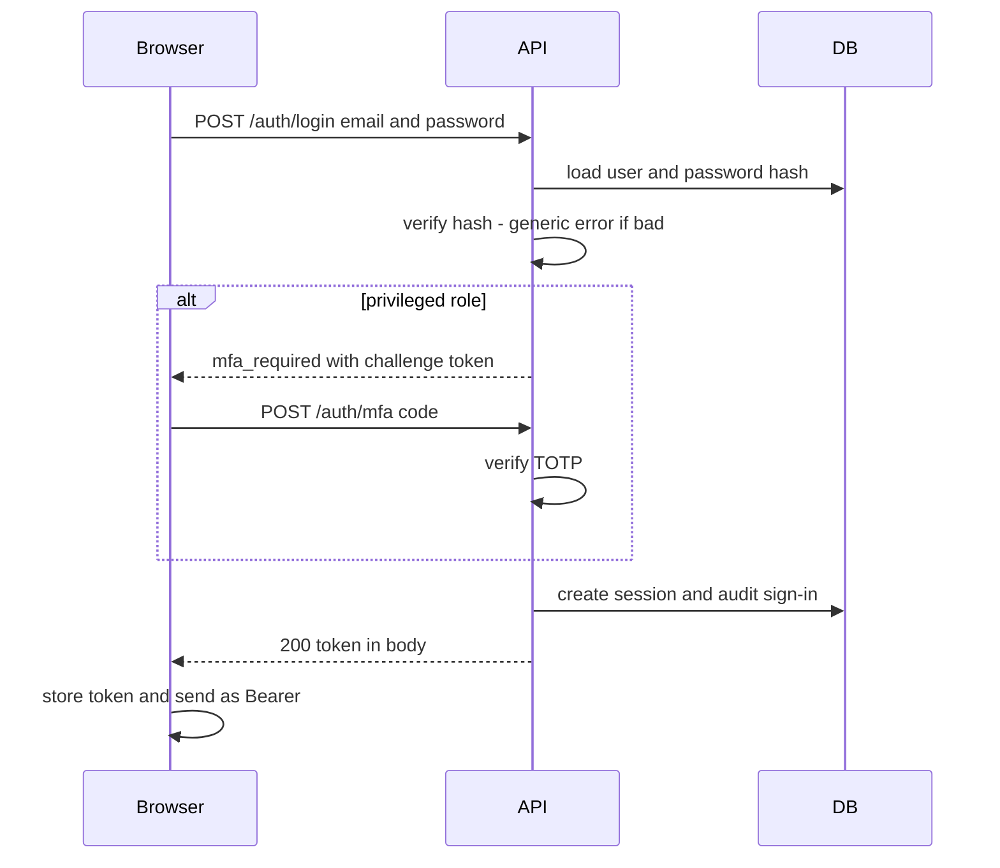
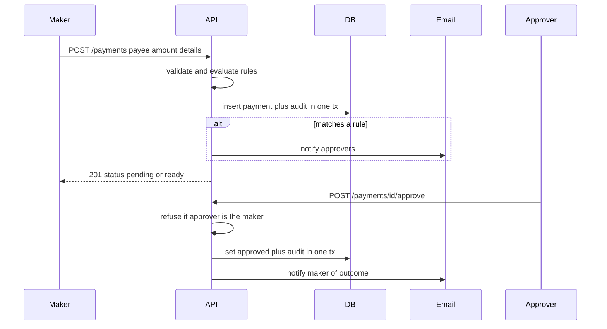
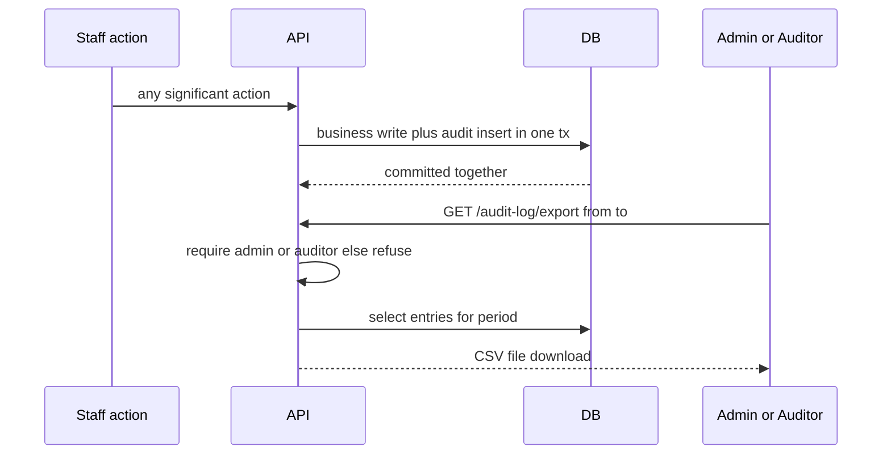
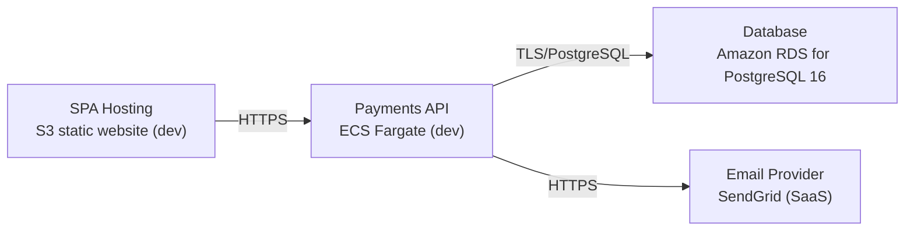

# Architecture

> Maintained by QuorQ AI SDLC. Text between `sdlc:auto` markers is regenerated; anything outside them is yours and is kept.

<!-- sdlc:auto:start narrative -->
## Overview

### ARCH-OVERVIEW · approved · source: architecture:summary

kkkess is a private, internal maker-checker payments tool for a single UK/£ organisation: staff create payment instructions against a managed payee register, high-value payments need a second approver who is never the maker, and every action is recorded in an append-only audit log.

Architecture version 1, status approved. Built exactly on the approved stack: React 19 SPA, FastAPI 0.115, PostgreSQL 16, AWS London (eu-west-2). SPA and API are served from separate origins; sessions are carried as opaque Bearer tokens (not JWT). Privileged roles (approver/administrator) require a TOTP second factor. Treasury marks approved payments paid. SendGrid emails approvers and makers of pending items and outcomes. The system records payment instructions only and never moves money itself.

### ARCH-COMP-WEB · approved · source: architecture:components:web

Staff Web App is a role-aware React 19 single-page application covering sign-in, MFA entry, payee register, payment creation, approvals, dashboard, and audit viewing/export.

Component: Staff Web App (React 19). Stores the opaque session token issued at login/MFA and sends it as an Authorization: Bearer header on every API call. Screens render differently depending on the signed-in user's role (maker, approver, treasury, administrator/auditor).

### ARCH-COMP-API · approved · source: architecture:components:api

Payments API is the FastAPI 0.115 backend enforcing authentication, TOTP MFA, role-based access, maker-checker separation, approval-rule evaluation, payment/payee lifecycle transitions, transactional writes and append-only audit records.

Component: Payments API (FastAPI 0.115). Responsibilities: authenticate users and verify TOTP for privileged roles; enforce role-based access control; enforce maker-checker separation (an approver may never approve their own payment); evaluate active approval rules to route payments; manage payment and payee lifecycle state; perform transactional writes so a business change and its audit entry commit together; trigger SendGrid email notifications on pending/outcome events.

### ARCH-COMP-DB · approved · source: architecture:components:db

PostgreSQL 16 is the transactional store for users, roles, sessions, payees, pending bank-detail changes, payments, approval rules and the append-only audit log.

Component: PostgreSQL Database (PostgreSQL 16). Encryption at rest is enabled and the database is pinned to the London (eu-west-2) region. Hosted as Amazon RDS for PostgreSQL 16 per the deployment design.

### ARCH-COMP-EMAIL · approved · source: architecture:components:email

Transactional Email uses SendGrid to send approval-pending and approval-outcome notifications.

Component: Transactional Email (SendGrid). Uses a single API key. Missing-key or send failures are surfaced to the caller/log rather than silently swallowed, so notification failures are visible.

### ARCH-PATH-LOGIN-MFA · approved · source: architecture:critical_paths:Sign in with MFA and opaque session token

Staff authenticate with email/password; privileged users (approver/administrator) must additionally pass a TOTP check before a session token is issued.

Flow: 1) Staff submit email/password to POST /auth/login. 2) On success, a privileged user (approver/administrator) is required to pass TOTP via POST /auth/mfa before a session is issued; non-privileged users get a token directly. 3) The login/MFA response returns an opaque token in the response body; the SPA stores it and sends it as an Authorization: Bearer header on subsequent calls. 4) Failure returns a generic message that does not reveal whether the email or password was wrong. 5) Passwords are verified against a stored hash, never in plaintext. 6) Every sign-in attempt (success or failure) is audited.

### ARCH-PATH-MAKER-CHECKER · approved · source: architecture:critical_paths:Maker-checker payment creation and approval

A maker creates a payment against an approved payee; the API validates and routes it through approval rules, and a different person must approve or reject it before it can be paid.

Flow: 1) A maker creates a payment (POST /payments) against an approved payee. 2) The API validates amount and fields and evaluates active approval rules. 3) The payment is set to pending_approval (approvers are notified by email) or to approved/ready-to-pay, depending on rule evaluation. 4) An approver who is not the maker approves (POST /payments/{id}/approve) or rejects (POST /payments/{id}/reject) the payment; a self-approval attempt by the maker is refused. 5) Each state change writes the payment update and its audit entry within a single transaction. 6) The maker is emailed the outcome.

### ARCH-PATH-AUDIT · approved · source: architecture:critical_paths:Immutable audit logging and export

Every significant action appends an audit row in the same transaction as the business change; the audit log is append-only and can be viewed or exported only by admins and auditors.

Flow: 1) Every significant action (sign-in, payee/payment lifecycle change, rule change, etc.) appends an audit_log row in the same transaction as the underlying business change, so the two can never diverge. 2) The audit table is append-only: no UPDATE or DELETE privilege is granted, enforced by revoked privileges and DB triggers that block mutation. 3) Admins and auditors can view audit entries (GET /audit-log) and export entries for a period as a file (GET /audit-log/export, CSV). 4) Other roles attempting to view or export audit entries are refused.

### ARCH-DATA-MODEL · approved · source: architecture:entities

The relational schema covers users/roles/sessions, the payee register with pending bank-detail changes, payments with bank-detail snapshots, configurable approval rules, and an append-only audit log.

Entities: users(id, email, password_hash, mfa_secret, mfa_enabled, is_active, created_at); user_roles(id, user_id, role); sessions(token, user_id, created_at, last_active_at, expires_at, revoked_at); payees(id, name, account_name, sort_code, account_number, status, created_by, approved_by, created_at); payee_change_requests(id, payee_id, new_account_name, new_sort_code, new_account_number, status, requested_by, reviewed_by, created_at); payments(id, payee_id, amount, currency, details, status, snapshot_account_name, snapshot_sort_code, snapshot_account_number, created_by, approved_by, paid_by, created_at, approved_at, paid_at) -- payments snapshot payee bank details at creation time so later payee changes don't retroactively alter a submitted payment; approval_rules(id, name, condition_type, threshold_amount, payee_id, department, is_active, created_by, created_at); audit_log(id, actor_id, action, entity_type, entity_id, detail, created_at) -- append-only.

### ARCH-API-AUTH · approved · source: architecture:endpoints:auth

Authentication endpoints handle login, TOTP MFA verification, and session logout.

POST /auth/login - authenticate email and password; returns a session token or an MFA challenge for privileged roles, with a generic failure message. POST /auth/mfa - verify the TOTP second factor and issue the session token. POST /auth/logout - revoke the current session server-side.

### ARCH-API-USERS · approved · source: architecture:endpoints:users

User management endpoints let administrators list, create, edit and deactivate staff accounts and their role assignments.

GET /users - list staff accounts. POST /users - create a staff account and assign roles. PATCH /users/{id} - edit a user and role assignments. POST /users/{id}/deactivate - deactivate an account and revoke its active sessions.

### ARCH-API-PAYEES · approved · source: architecture:endpoints:payees

Payee endpoints manage the approval-controlled payee register, including registration, approval, and pending bank-detail change requests.

GET /payees - list payees with status; supports an approved-only filter for payment creation. POST /payees - register a new payee in pending state. GET /payees/{id} - view a payee with its current approved bank details and status. POST /payees/{id}/approve - approve a pending payee, by a different user than the one who registered it. POST /payees/{id}/bank-change - submit a bank-detail change held pending approval. POST /payee-changes/{id}/approve - approve a pending bank-detail change (not by the requester). POST /payee-changes/{id}/reject - reject a bank-detail change, leaving existing details unchanged.

### ARCH-API-PAYMENTS · approved · source: architecture:endpoints:payments

Payment endpoints cover creation, listing, viewing, approval/rejection, marking paid, and optional reconciliation.

POST /payments - create a payment for an approved payee; validates fields and routes by approval rules. GET /payments - list payments with payee, amount and status, filterable by status. GET /payments/{id} - view a single payment. POST /payments/{id}/approve - approve a pending payment; refused if the approver is the maker. POST /payments/{id}/reject - reject a pending payment. POST /payments/{id}/mark-paid - mark an approved payment as paid, recording time and identity. POST /payments/{id}/reconcile - optionally record a paid payment as reconciled/closed.

### ARCH-API-APPROVAL-RULES · approved · source: architecture:endpoints:approval-rules

Approval-rule endpoints let administrators list, create and edit the configurable rules that decide which payments need a second approver.

GET /approval-rules - list approval rules. POST /approval-rules - create an approval rule. PATCH /approval-rules/{id} - edit an approval rule.

### ARCH-API-DASHBOARD · approved · source: architecture:endpoints:dashboard

The dashboard endpoint gives a summary of payment counts by status and items awaiting the caller's approval.

GET /dashboard - returns payment counts by lifecycle status, plus items awaiting the calling user's approval.

### ARCH-API-AUDIT · approved · source: architecture:endpoints:audit-log

Audit-log endpoints let admins and auditors view and export the append-only audit trail.

GET /audit-log - view audit entries with actor, action, item and timestamp. GET /audit-log/export - export audit entries for a period as a CSV file. Per the audit critical path, only admin/auditor roles may use these; other roles are refused.

### ARCH-DEPLOYMENT · approved · source: architecture:deployment_nodes

The system deploys as a static SPA on S3, a FastAPI service on ECS Fargate, an RDS PostgreSQL 16 database, and SendGrid as an external email provider -- all in AWS eu-west-2 (dev environment as specified).

SPA Hosting: S3 static website (dev) serving the React 19 static build. Payments API: ECS Fargate (dev) running FastAPI 0.115 on Python 3.12 via Uvicorn. Database: Amazon RDS for PostgreSQL 16. Email Provider: SendGrid (SaaS) accessed over HTTPS API.

### ARCH-TECH-FRONTEND · approved · source: architecture:technology_decisions:Frontend

React 19 was chosen for the frontend over Vue and Angular to drive the role-dependent maker/approver/treasury/admin screens.

Decision: React 19 (alternatives considered: Vue, Angular). Built with Vite; reads the API base URL from VITE_API_BASE_URL. Drives role-dependent screens, forms, lists and the dashboard as a responsive SPA, and stores the opaque session token to send as a Bearer header.

### ARCH-TECH-BACKEND · approved · source: architecture:technology_decisions:Backend

FastAPI 0.115 was chosen for the backend over Django and Flask to host the maker-checker rules, validation and audit writes.

Decision: FastAPI 0.115 (alternatives considered: Django, Flask). Hosts maker-checker rules, threshold evaluation, strict validation of payments and payee changes, lifecycle transitions and transactional audit writes. Pydantic validation rejects non-positive amounts and missing fields before persistence.

### ARCH-TECH-DATABASE · approved · source: architecture:technology_decisions:Database

PostgreSQL 16 was chosen over MySQL and SQL Server for transactional integrity and enforceable append-only audit storage.

Decision: PostgreSQL 16 (alternatives considered: MySQL, SQL Server). Gives transactional all-or-nothing writes for payment+approval+audit, and enforces an append-only audit log via revoked UPDATE/DELETE privileges plus a blocking trigger. The numeric type keeps money values exact.

### ARCH-TECH-CLOUD · approved · source: architecture:technology_decisions:Cloud

AWS was chosen over Azure and GCP, with everything pinned to London (eu-west-2) for data residency and security controls appropriate to a private internal tool.

Decision: AWS (alternatives considered: Azure, GCP). Everything pinned to London (eu-west-2) for GDPR-style data residency, with RDS encryption at rest, TLS in transit, backups and IAM access controls.
<!-- sdlc:auto:end narrative -->

<!-- sdlc:auto:start building-blocks -->
## Building Block View

| ID | Name | Technology | Responsibility | Depends on |
|---|---|---|---|---|
| web | Staff Web App | React 19 | Role-aware React SPA for sign-in, MFA entry, payee register, payment creation, approvals, dashboard, audit viewing/export. Stores the opaque session token and sends it as Authorization: Bearer on every call. | api |
| api | Payments API | FastAPI 0.115 | FastAPI service enforcing authentication, TOTP MFA, role-based access, maker-checker separation, approval-rule evaluation, payment/payee lifecycle, transactional writes and append-only audit records. Triggers email notifications. | db, email |
| db | PostgreSQL Database | PostgreSQL 16 | Transactional store for users, roles, sessions, payees, pending bank-detail changes, payments, approval rules and the append-only audit log, with encryption at rest, pinned to the London region. | — |
| email | Transactional Email | SendGrid | Sends approval-pending and approval-outcome notifications via SendGrid using a single API key; missing-key or send failures are surfaced, not swallowed. | — |

<!-- sdlc:auto:end building-blocks -->

<!-- sdlc:auto:start runtime -->
## Runtime View

### Sign in with MFA and opaque session token

Staff submit email/password; on success a privileged user (approver/administrator) must pass TOTP before a session is issued. The login/MFA response returns an opaque token in the body; the SPA stores it and sends it as Authorization: Bearer. A generic failure message hides which field was wrong, passwords are verified against a hash, and every sign-in is audited.

- **Components:** web, api, db
- **Modules:** auth_router, auth_service, mfa_service, session_store, audit_service
- **Key functions:** login(email, password), verify_password(hash, password), verify_totp(secret, code), issue_session(user_id), record_audit(actor, action, entity)

### Maker-checker payment creation and approval

A maker creates a payment against an approved payee; the API validates amount and fields, evaluates active approval rules, and sets status pending_approval (notifying approvers) or approved/ready-to-pay. An approver who is not the maker approves or rejects it; a self-approval attempt is refused. Each step writes the payment change and its audit entry in one transaction and emails the maker of the outcome.

- **Components:** web, api, db, email
- **Modules:** payments_router, payment_service, rule_engine, audit_service, notification_service
- **Key functions:** create_payment(payee_id, amount, details, maker), evaluate_rules(payment), approve_payment(payment_id, approver), reject_payment(payment_id, approver), assert_not_self(maker_id, actor_id)

### Immutable audit logging and export

Every significant action appends an audit row in the same transaction as the business change. The audit table is append-only (no UPDATE/DELETE granted; enforced by DB triggers/revoked privileges). Admins and auditors view and export entries for a period as a file; other roles are refused.

- **Components:** web, api, db
- **Modules:** audit_service, audit_router, rbac_guard, export_service
- **Key functions:** record_audit(actor, action, entity_type, entity_id), list_audit(filters, role), export_audit(from, to), require_role(roles)

<!-- sdlc:auto:end runtime -->

<!-- sdlc:auto:start deployment-view -->
## Deployment View

| Name | Service | Runtime | Scaling | Environment |
|---|---|---|---|---|
| SPA Hosting | S3 static website (dev) | React 19 static build | static objects | dev |
| Payments API | ECS Fargate (dev) | FastAPI 0.115 on Python 3.12 (Uvicorn) | 1-2 tasks, modest internal load | dev |
| Database | Amazon RDS for PostgreSQL 16 | PostgreSQL 16 | single instance with automated backups | dev |
| Email Provider | SendGrid (SaaS) | HTTPS API | managed | dev |

| Source | Target | Protocol |
|---|---|---|
| SPA Hosting | Payments API | HTTPS |
| Payments API | Database | TLS/PostgreSQL |
| Payments API | Email Provider | HTTPS |

<!-- sdlc:auto:end deployment-view -->

<!-- sdlc:auto:start decisions -->
## Architecture Decisions

| Layer | Choice | ADR |
|---|---|---|
| Frontend | React 19 | [ADR-0001](adr/frontend.md) |
| Backend | FastAPI 0.115 | [ADR-0002](adr/backend.md) |
| Database | PostgreSQL 16 | [ADR-0003](adr/database.md) |
| Cloud | AWS | [ADR-0004](adr/cloud.md) |
<!-- sdlc:auto:end decisions -->

<!-- sdlc:auto:start links -->
## Related Documents

- [Data Model](data-model.md)
- [API Specification](api/openapi.yaml)
- [Architecture Decision Records](adr/README.md)
<!-- sdlc:auto:end links -->
