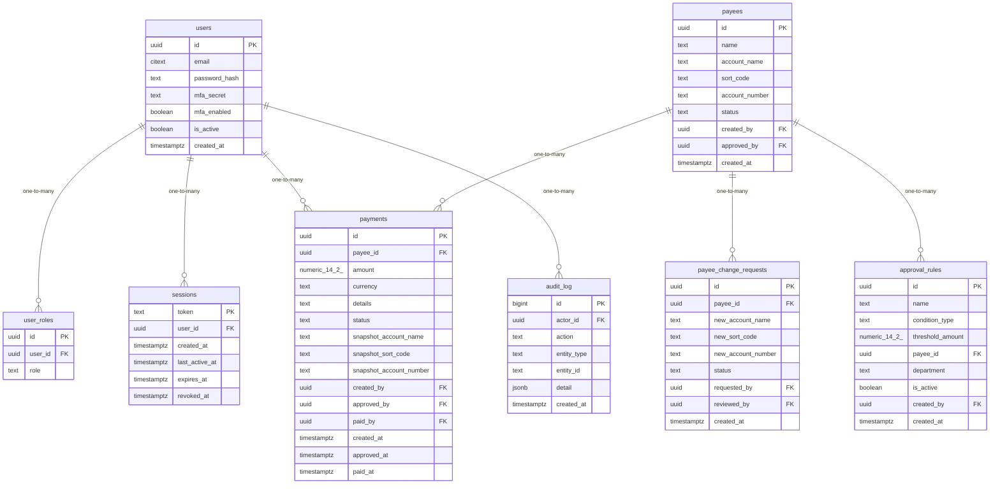

# Data Model

<!-- sdlc:auto:start entities -->
### users

| Field | Type | PK | FK | Nullable |
|---|---|---|---|---|
| id | uuid | True | — | False |
| email | citext | False | — | False |
| password_hash | text | False | — | False |
| mfa_secret | text | False | — | True |
| mfa_enabled | boolean | False | — | False |
| is_active | boolean | False | — | False |
| created_at | timestamptz | False | — | False |

### user_roles

| Field | Type | PK | FK | Nullable |
|---|---|---|---|---|
| id | uuid | True | — | False |
| user_id | uuid | False | users.id | False |
| role | text | False | — | False |

### sessions

| Field | Type | PK | FK | Nullable |
|---|---|---|---|---|
| token | text | True | — | False |
| user_id | uuid | False | users.id | False |
| created_at | timestamptz | False | — | False |
| last_active_at | timestamptz | False | — | False |
| expires_at | timestamptz | False | — | False |
| revoked_at | timestamptz | False | — | True |

### payees

| Field | Type | PK | FK | Nullable |
|---|---|---|---|---|
| id | uuid | True | — | False |
| name | text | False | — | False |
| account_name | text | False | — | False |
| sort_code | text | False | — | False |
| account_number | text | False | — | False |
| status | text | False | — | False |
| created_by | uuid | False | users.id | False |
| approved_by | uuid | False | users.id | True |
| created_at | timestamptz | False | — | False |

### payee_change_requests

| Field | Type | PK | FK | Nullable |
|---|---|---|---|---|
| id | uuid | True | — | False |
| payee_id | uuid | False | payees.id | False |
| new_account_name | text | False | — | False |
| new_sort_code | text | False | — | False |
| new_account_number | text | False | — | False |
| status | text | False | — | False |
| requested_by | uuid | False | users.id | False |
| reviewed_by | uuid | False | users.id | True |
| created_at | timestamptz | False | — | False |

### payments

| Field | Type | PK | FK | Nullable |
|---|---|---|---|---|
| id | uuid | True | — | False |
| payee_id | uuid | False | payees.id | False |
| amount | numeric(14,2) | False | — | False |
| currency | text | False | — | False |
| details | text | False | — | True |
| status | text | False | — | False |
| snapshot_account_name | text | False | — | False |
| snapshot_sort_code | text | False | — | False |
| snapshot_account_number | text | False | — | False |
| created_by | uuid | False | users.id | False |
| approved_by | uuid | False | users.id | True |
| paid_by | uuid | False | users.id | True |
| created_at | timestamptz | False | — | False |
| approved_at | timestamptz | False | — | True |
| paid_at | timestamptz | False | — | True |

### approval_rules

| Field | Type | PK | FK | Nullable |
|---|---|---|---|---|
| id | uuid | True | — | False |
| name | text | False | — | False |
| condition_type | text | False | — | False |
| threshold_amount | numeric(14,2) | False | — | True |
| payee_id | uuid | False | payees.id | True |
| department | text | False | — | True |
| is_active | boolean | False | — | False |
| created_by | uuid | False | users.id | False |
| created_at | timestamptz | False | — | False |

### audit_log

| Field | Type | PK | FK | Nullable |
|---|---|---|---|---|
| id | bigint | True | — | False |
| actor_id | uuid | False | users.id | True |
| action | text | False | — | False |
| entity_type | text | False | — | False |
| entity_id | text | False | — | True |
| detail | jsonb | False | — | True |
| created_at | timestamptz | False | — | False |
<!-- sdlc:auto:end entities -->

<!-- sdlc:auto:start relationships -->
| Source | Target | Type |
|---|---|---|
| users | user_roles | one-to-many |
| users | sessions | one-to-many |
| users | payments | one-to-many |
| payees | payments | one-to-many |
| payees | payee_change_requests | one-to-many |
| payees | approval_rules | one-to-many |
| users | audit_log | one-to-many |
<!-- sdlc:auto:end relationships -->

<!-- sdlc:auto:start er-diagram -->

<!-- sdlc:auto:end er-diagram -->
