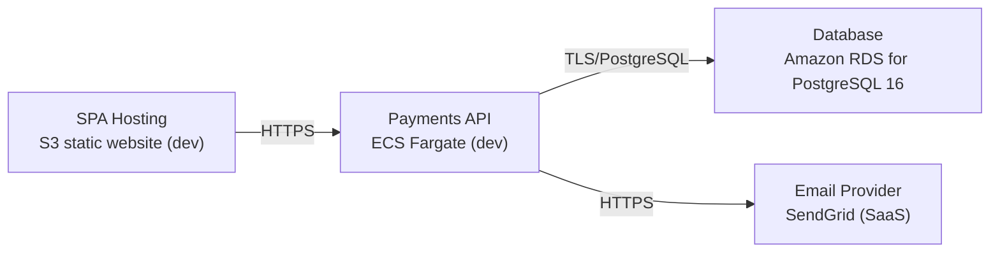

# Deployment Guide

> Maintained by QuorQ AI SDLC. Text between `sdlc:auto` markers is regenerated; anything outside them is yours and is kept.

<!-- sdlc:auto:start how-it-deploys -->
Pushes to `main` run `.github/workflows/deploy.yml`, which builds the API image (if there is a backend) and deploys the SPA to AWS Amplify. Commits touching only `docs/sdlc/**` don't deploy. Deployments can also be started from the platform's Deployment tab.
<!-- sdlc:auto:end how-it-deploys -->

<!-- sdlc:auto:start environments -->
| Name | Service | Runtime | Scaling | Environment |
|---|---|---|---|---|
| SPA Hosting | S3 static website (dev) | React 19 static build | static objects | dev |
| Payments API | ECS Fargate (dev) | FastAPI 0.115 on Python 3.12 (Uvicorn) | 1-2 tasks, modest internal load | dev |
| Database | Amazon RDS for PostgreSQL 16 | PostgreSQL 16 | single instance with automated backups | dev |
| Email Provider | SendGrid (SaaS) | HTTPS API | managed | dev |
<!-- sdlc:auto:end environments -->

<!-- sdlc:auto:start live -->
_Not deployed yet._
<!-- sdlc:auto:end live -->

<!-- sdlc:auto:start topology -->

<!-- sdlc:auto:end topology -->
